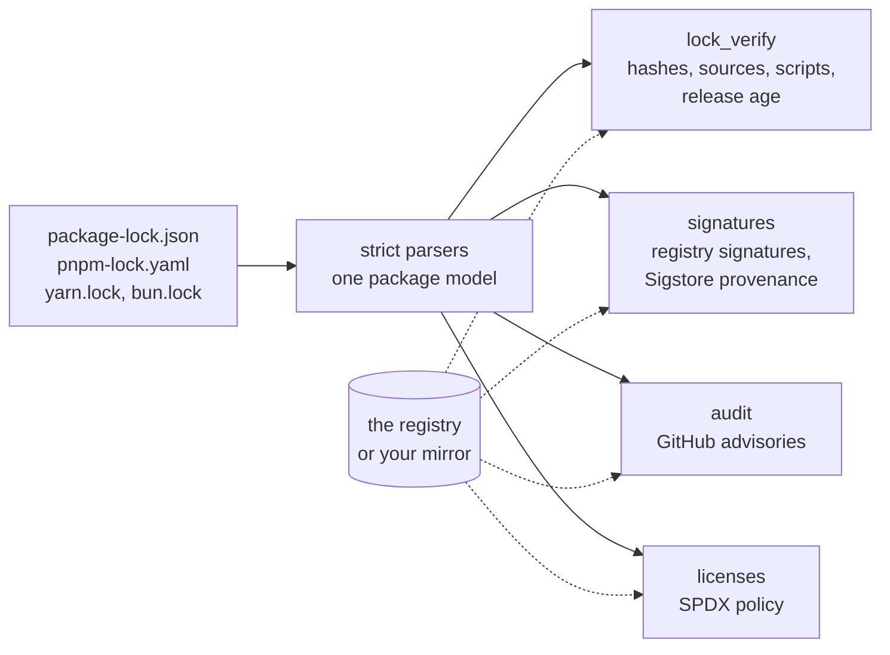

<div align="center">

# JavaScript Supply-Chain Security for CircleCI and GitHub Actions

### Check every package your lockfiles pin, for npm, pnpm, Yarn and bun alike, without installing a thing.

Run four checks on a JavaScript or TypeScript project's lockfiles, as orb commands or GitHub Actions: lockfile hygiene and release age, npm registry signatures and Sigstore provenance, known vulnerabilities, and licenses. Nothing is installed and nothing in `node_modules` runs.<br>
Registry signatures bound to your lockfile · Provenance from the repositories you name · No trust downgrades<br>
An audit that can't pass by accident · Strict SPDX · SARIF, JUnit and run records · No `sudo`

[](https://circleci.com/gh/juburr/js-security-orb)
[](https://github.com/juburr/js-security-orb/actions/workflows/actions.yml)
[](https://circleci.com/developer/orbs/orb/juburr/js-security-orb)
[](LICENSE)
[](https://discuss.circleci.com/c/ecosystem/orbs)


**[Quick Start](#-quick-start)** · **[Features](#-why-js-security-orb)** · **[Recipes](#-recipes)** · **[Commands](#-commands)** · **[GitHub Actions](#-github-actions)** · **[Security](#-secure-by-design)** · **[Network Access](#-network-access)**

<sub>An unofficial, community-maintained CircleCI orb and set of GitHub Actions, not affiliated with npm, GitHub, the OpenJS Foundation or Sigstore. [Contributions are welcome!](#-contributing)</sub>

</div>

<br>

## ✨ Why js-security-orb?

<table>
<tr>
<td width="33%" valign="top">
📦 <b>Every package manager, nothing installed</b><br><br>
The checks read <code>package-lock.json</code>, <code>npm-shrinkwrap.json</code>, <code>pnpm-lock.yaml</code>, <code>yarn.lock</code> (Yarn 1 and Berry) and <code>bun.lock</code> directly, with strict parsers that fail on anything they don't understand. No <code>npm install</code>, no <code>node_modules</code>, no install scripts: a malicious package can't run before it is checked.
</td>
<td width="33%" valign="top">
✍️ <b>Signatures bound to your lockfile</b><br><br>
<code>signatures</code> verifies npm's registry signature over the integrity hash your lockfile pins, against npm's keys pinned in the orb, so a lockfile pointing at a tarball the registry never published fails. <code>npm audit signatures</code> only checks an npm install's <code>node_modules</code>.
</td>
<td width="33%" valign="top">
🔏 <b>Provenance you can require</b><br><br>
Each Sigstore attestation is verified offline against a pinned trusted root: the certificate chain, the transparency log and the subject. Then require provenance for the packages that matter, from the repositories you name (by URL, or by GitHub's repository ID, which survives a transfer), and refuse a version that drops the trust its predecessors had.
</td>
</tr>
<tr>
<td width="33%" valign="top">
🚨 <b>An audit that can't pass by accident</b><br><br>
<code>audit</code> asks the registry's bulk advisory endpoint, as <code>npm audit</code> does, for every package manager's lockfile, and matches each locked version itself. A canary, <code>minimist@0.0.8</code>, must come back with its two advisories, so a mirror that answers with nothing fails instead of passing. Private package names are never sent.
</td>
<td width="33%" valign="top">
⚖️ <b>Licenses as SPDX, strictly</b><br><br>
Each locked version's license comes from its registry metadata and is parsed against the SPDX License List: <code>MIT OR GPL-3.0</code> passes with MIT allowed, <code>MIT AND CC-BY-4.0</code> doesn't. A license that can't be read (none, <code>UNLICENSED</code>, free text) is a finding until you <code>clarify</code> it.
</td>
<td width="33%" valign="top">
🧹 <b>Hygiene and a cooling-off period</b><br><br>
<code>lock_verify</code> wants an integrity hash stronger than SHA-1 for every download, packages only from your registries, no git or tarball dependencies or install scripts you didn't allow, and versions published at least 7 days ago, since most malicious releases are found and pulled within days.
</td>
</tr>
</table>

### 🧩 The Orb vs. the Package Managers' Own Commands

| | `npm audit`, `pnpm audit`, `yarn npm audit` | js-security-orb |
|---|---|---|
| Lockfiles | each reads its own | npm, pnpm, Yarn 1 and Berry, bun, with one set of rules |
| What it needs | the package manager the project uses; `npm audit signatures` also an install | Node.js; nothing is installed or run |
| Registry signatures | `npm audit signatures`, npm only, after an install, over what was installed | over the integrity each lockfile pins, against npm's keys pinned in the orb |
| Provenance | shown, never required | required per package, from named repositories, and no downgrades |
| An advisory endpoint that answers `{}` | passes | fails: the canary must come back |
| Package names from a private registry | sent to the public registry in some setups | never sent anywhere but their own registry |
| Release age | each package manager's own setting, applied when it installs | checked on every lockfile in CI |
| Licenses | not checked | an SPDX policy |
| Output | text or JSON | JSON, SARIF for code scanning, JUnit for test tabs, run records |

## 🔄 How It Works



1. **`install`** puts a verified Node.js on the `PATH` as `js-security-node`, for images without Node.js 22 or newer. Images such as `cimg/node` need nothing.
2. Each check reads the lockfiles in `working_dir`, asks the registry what it needs (packuments, attestations, advisories) with curl, and writes `<report_name>.json`, `.sarif` and `junit/<report_name>.xml` to `output_dir`.
3. Findings fail the step unless `report_only` is true. A check that couldn't finish, or that had nothing to check, fails it either way.

## 🚀 Quick Start

### CircleCI

```yaml
version: 2.1

orbs:
  js-security: juburr/js-security-orb@0.1.0

jobs:
  dependencies:
    docker:
      - image: cimg/node:current
    steps:
      - checkout
      - js-security/lock_verify
      - js-security/signatures
      - js-security/audit
      - js-security/licenses

workflows:
  build:
    jobs:
      - dependencies
```

Each check finds the lockfiles in the checkout, fails the job on what it finds, and stores its reports as artifacts under `js-security-reports/` and its findings in the job's Tests tab. On an image without Node.js 22 or newer, such as `cimg/base`, add `js-security/install` first.

### GitHub Actions

```yaml
jobs:
  dependencies:
    runs-on: ubuntu-24.04
    steps:
      - uses: actions/checkout@v7
        with:
          persist-credentials: false
      - uses: juburr/js-security-orb/actions/install@v0.1.0
      - uses: juburr/js-security-orb/actions/lock_verify@v0.1.0
      - uses: juburr/js-security-orb/actions/signatures@v0.1.0
      - uses: juburr/js-security-orb/actions/audit@v0.1.0
      - uses: juburr/js-security-orb/actions/licenses@v0.1.0
```

Each check uploads its reports as an artifact named `js-security-reports-<report_name>-<random>`.

## 🍳 Recipes

### Require Provenance

```yaml
- js-security/signatures:
    require_provenance: "@corp/*, react, react-dom"
    provenance_sources: |
      @corp/*=id:123456789
      react=https://github.com/facebook/react
      react-dom=https://github.com/facebook/react
    no_downgrade: true
```

Every `@corp` package, React and React DOM must have verified SLSA provenance, and it must name the repository given: `@corp` packages by GitHub's numeric repository ID, which a rename or a transfer doesn't change (`gh api repos/OWNER/REPO --jq .id`). `no_downgrade` fails any locked version published with weaker trust evidence than an earlier version of the same package (from strongest: a staged publish, a trusted publisher, provenance, none), as pnpm's `trustPolicy: no-downgrade` does: the sign of a stolen token.

### A Private Registry or Mirror

```yaml
- js-security/audit:
    registry: https://npm.example.com/api/npm/npm-remote
    token: NPM_TOKEN
    scopes: "@corp=https://npm.example.com/api/npm/npm-corp"
```

`registry` is where metadata comes from: a mirror of registry.npmjs.org serves the packages a lockfile records from either. The package managers' own registry settings must agree with it: a `registry=` line in the project's `.npmrc` or the user's npmrc (`NPM_CONFIG_USERCONFIG`, else `~/.npmrc`), `npmRegistryServer` in the project's `.yarnrc.yml`, or `npm_config_registry` naming another registry stops the step (exit 2) before any request, since the packages a pnpm or Yarn Berry lockfile records no registry for would otherwise be looked up, by name, on the wrong one. `scopes` sends a scope's packages to its own registry, and so do the `@scope:registry=` lines of the project's `.npmrc` and the user's npmrc and the `npmScopes` of the project's `.yarnrc.yml` (`scopes` wins, then `.npmrc`, `.yarnrc.yml` and the user's npmrc). `${VAR}` in them is expanded as npm, pnpm and Yarn do; a scope whose registry can't be resolved (an unset variable, or not an `https://` URL) is looked up nowhere, with a warning, and a value a variable supplies never appears in a message or report. Only credentials-free registry settings are read, never a token. `scopes` and the user's npmrc are the job's configuration; the checkout's `.npmrc` and `.yarnrc.yml` only route lookups, since the change under test can edit them, so `lock_verify` doesn't allow a registry only they name. A file the orb can't read exactly for these settings stops the step, naming the line. `token` names the variable holding a bearer token, from a context; it goes only to `registry`'s origin, in a curl config file, never on a command line. A 401 or 403 from `registry`'s origin fails the check; one from a scope's registry on another origin, which never gets the token, lists that registry's packages as not checked, with a warning. Packages from any other registry are listed as not checked, with a warning, never as passed, and their names are never sent elsewhere. `audit` needs a registry that serves npm's bulk advisory endpoint (Verdaccio proxies npm's by default; the canary tells you if yours doesn't), and `signatures` a mirror that keeps npm's signatures in what it serves: a package the lockfile records from registry.npmjs.org that the mirror serves without npm's signature is an `unsigned` finding.

### Adopt a Check Gradually

```yaml
- js-security/licenses:
    report_only: true
```

`report_only` reports every finding without failing the step, while you clarify licenses or allow what you mean to allow. A check that couldn't finish still fails it.

### Allow What You Mean To

```yaml
- js-security/lock_verify:
    allow_scripts: esbuild, sharp, "@swc/core"
    allow_git: my-fork
    release_age_exclude: "@corp/*"
- js-security/licenses:
    allowed_licenses: 0BSD, Apache-2.0, BSD-2-Clause, BSD-3-Clause, ISC, MIT, MPL-2.0
    clarify: |
      # Checked by hand: the LICENSE file is MIT.
      busboy@1.6.0=MIT
- js-security/audit:
    fail_on: high
    ignore: GHSA-35jh-r3h4-6jhm
```

### Several Projects, or a Monorepo

```yaml
- js-security/audit:
    lockfiles: "apps/*/package-lock.json, packages/tool/pnpm-lock.yaml"
```

`lockfiles` takes paths and globs relative to `working_dir`. Workspace packages are the project's own and are never looked up in a registry. Run a command twice with different `working_dir`s and `report_name`s to keep the reports apart.

### Keep a Run Record

`run_record: true` writes `<report_name>.run-record.json` ([schema](schemas/run-record.v1.json)): what was checked, from which lockfiles (with their SHA-256), against which registry, with which Node.js, in which CircleCI job or GitHub Actions run, and what was found.

## 🧰 Commands

| Command | What it does |
|---|---|
| [`install`](#js-securityinstall) | Installs Node.js, verified against this orb's checksum table, as `js-security-node` |
| [`lock_verify`](#js-securitylock_verify) | Lockfile hygiene: integrity hashes, sources, install scripts, release age, deprecated and unpublished versions |
| [`signatures`](#js-securitysignatures) | Verifies registry signatures and Sigstore attestations; provenance policies |
| [`audit`](#js-securityaudit) | Known vulnerabilities, from the GitHub advisories npm audit uses |
| [`licenses`](#js-securitylicenses) | Every package's license against an SPDX allowlist |

Every check takes these parameters:

| Parameter | Default | Description |
|---|---|---|
| `working_dir` | `.` | The project directory. |
| `lockfiles` | | Lockfiles to check, as paths or globs relative to `working_dir`, separated by commas, spaces or newlines. Empty checks every `package-lock.json`, `npm-shrinkwrap.json`, `pnpm-lock.yaml`, `yarn.lock` and `bun.lock` in `working_dir`. A binary `bun.lockb` is refused, with the command that converts it. |
| `include_dev` | `true` | Check development dependencies too. pnpm 9, Yarn and bun lockfiles don't mark them, so theirs are all checked, with a warning. |
| `registry` | `https://registry.npmjs.org` | The registry to read metadata from, or a mirror of it. A `registry=`, `npmRegistryServer` or `npm_config_registry` setting that names another one stops the step (see [A Private Registry or Mirror](#a-private-registry-or-mirror)). |
| `token` | | The name of a variable holding a bearer token for `registry`, sent only to its origin. |
| `scopes` | | `@scope=URL` lines, for scopes with a registry of their own; they win over the project's `.npmrc` and `.yarnrc.yml` and the user's npmrc, which are read too. |
| `concurrency` | `16` | Registry requests at once. |
| `timeout` | `60` | Seconds per request, after which it is retried, up to three times. |
| `allow_empty` | `false` | Pass when there is nothing to check, rather than failing. |
| `output_dir` | `/tmp/js-security-reports` | Where the reports go. Not expanded. |
| `report_name` | the command's name | The reports' base name. An earlier run's reports with this name are removed first. |
| `junit` | `true` | Write and store JUnit, one failed test case per finding. |
| `run_record` | `false` | Write a run record. |
| `report_only` | `false` | Report findings without failing the step. |
| `store_artifacts` | `true` | Store `output_dir` as artifacts, also when the step fails. |

Every parameter but `output_dir` and `report_name` expands environment variables. Each check also writes `<report_name>.sarif`, which GitHub code scanning reads, and `<report_name>.json`, with every finding, warning and skipped package.

### `js-security/install`

| Parameter | Default | Description |
|---|---|---|
| `version` | `26.12.1` | The Node.js release to install (22, 24 and 26 are listed). |
| `verify_checksums` | `strict` | `strict` refuses a release the table doesn't list, before downloading; `known_versions` installs it unverified, with a warning; `false` verifies nothing. |
| `install_path` | `$HOME/.js-security-orb` | The installation's root; its `bin`, which holds only the `js-security-node` launcher, goes on the `PATH` of later steps. The job's own `node`, `npm` and `npx` stay as they were. |
| `caching` | `true` | Cache the verified release between jobs. |
| `download_base_url` | | An `https://` mirror of `https://nodejs.org/dist`, such as Artifactory. The table still decides what is installed. |

The checks run with `js-security-node` when it is on the `PATH`, else with `node`, which must be 22 or newer.

### `js-security/lock_verify`

| Parameter | Default | Description |
|---|---|---|
| `allowed_registries` | | Registries a lockfile may record packages from: an origin allows the whole host, a longer URL the paths below it. Empty allows `registry`, the `scopes` registries and those of the user's npmrc, and registry.npmjs.org for a package npm installs from one of them in its place; not a registry only the checkout's `.npmrc` or `.yarnrc.yml` names. A list is the whole list. |
| `allow_git` | | Packages that may come from git (names, `@scope/*`, `*`). Each must still name a full commit. |
| `allow_remote` | | Packages that may be tarballs from another URL. They still need an integrity hash. |
| `allow_local` | | Packages that may come from a path outside the checkout. |
| `allow_scripts` | | Packages that may run install scripts (`name`, `name@version`, patterns). A git or tarball package whose install scripts neither the lockfile nor a registry describes must be allowed too. |
| `min_release_age_days` | `7` | Report a version published fewer days ago than this, or with no publish time. 0 turns it off. |
| `release_age_exclude` | | Packages the release age doesn't apply to. |
| `fail_on_deprecated` | `false` | Fail on deprecated versions, which are otherwise warnings. |
| `offline` | `false` | Check only the lockfiles, asking no registry. A warning lists the registry packages whose install scripts are then unknown. |

Findings: `no-integrity`, `weak-integrity` (SHA-1 only), `registry`, `git`, `git-unpinned`, `remote`, `local`, `install-script`, `too-new`, `no-publish-time`, `unpublished`, and `deprecated` with `fail_on_deprecated`.

### `js-security/signatures`

| Parameter | Default | Description |
|---|---|---|
| `require_signatures` | `false` | Make packages from a registry that signs nothing, or whose registry wasn't asked (another registry, or a 401 or 403 from one that never gets the token), unsigned findings, rather than not checked. A package missing a signature from a registry that signs others, or recorded from registry.npmjs.org, is a finding either way. |
| `allow_unbound` | `false` | Verify packages whose lockfile integrity can't be bound to a signature (Yarn Berry's checksums, pnpm's `integrityTarget: tar`, SHA-1 only) against the registry's own integrity, with a warning, rather than giving no verdict. |
| `require_provenance` | | Packages that must have verified SLSA provenance. One this check skips (git, a tarball URL, a local path, bundled, another registry) is a finding too. |
| `provenance_sources` | | `pattern=REPOSITORY` lines: the repository a package's provenance must name, as `https://github.com/OWNER/REPO` or `id:NUMBER`. A URL matches only provenance its forge's CI signed for (GitHub Actions for github.com). |
| `no_downgrade` | `false` | Fail on a version published with weaker trust evidence than an earlier one. |
| `downgrade_exclude` | | Packages `no_downgrade` leaves alone. |

Findings: `integrity-mismatch` (the lockfile pins another integrity than the registry's), `not-in-registry`, `invalid` (a signature that doesn't verify), `unsigned`, `invalid-attestation`, `unsupported-attestation` (for a package that needs provenance), `missing-provenance`, `provenance-source` and `provenance-downgrade`. A signature by a key the orb doesn't know is no verdict: the orb needs an update.

### `js-security/audit`

| Parameter | Default | Description |
|---|---|---|
| `fail_on` | `low` | The lowest severity that fails: `low`, `moderate`, `high` or `critical`. Lower ones are warnings. |
| `ignore` | | GHSA IDs to ignore, such as `GHSA-35jh-r3h4-6jhm`. One that matches nothing is a warning. |

Each finding is `audit/<GHSA ID>`, with its severity as SARIF's `security-severity`.

### `js-security/licenses`

| Parameter | Default | Description |
|---|---|---|
| `allowed_licenses` | `0BSD, Apache-2.0, BlueOak-1.0.0, BSD-2-Clause, BSD-3-Clause, CC0-1.0, ISC, MIT, Unlicense` | SPDX identifiers packages may have. `OR` needs one allowed side, `AND` every part, `X WITH E` needs X (and E, once you list any exception). `LicenseRef-` identifiers only when listed exactly. |
| `clarify` | | `name=EXPRESSION` or `name@version=EXPRESSION` lines, for licenses the metadata gets wrong or leaves out. Globs allowed; `#` starts a comment. |
| `offline` | `false` | Read licenses from npm lockfiles (v2 and v3) instead of the registry. |

Findings: `denied`, and `unknown` (no license, `UNLICENSED`, `SEE LICENSE IN`, not SPDX, or a version the registry doesn't have). The JSON report lists every package's license and how many packages have each.

## ⚡ GitHub Actions

Every command has a composite action of the same name, with the same inputs and defaults, running the same scripts:

| Action | Command |
|---|---|
| `juburr/js-security-orb/actions/install@v0.1.0` | `install` |
| `juburr/js-security-orb/actions/lock_verify@v0.1.0` | `lock_verify` |
| `juburr/js-security-orb/actions/signatures@v0.1.0` | `signatures` |
| `juburr/js-security-orb/actions/audit@v0.1.0` | `audit` |
| `juburr/js-security-orb/actions/licenses@v0.1.0` | `licenses` |

A few differences:

- **Quote booleans and numbers** in `with:` (`report_only: "true"`), since every input is a string.
- **Environment variables aren't expanded in inputs.** Use `${{ env.NAME }}` instead.
- **The token** goes in the `env` of the step, from a secret: `env: NPM_TOKEN: ${{ secrets.NPM_TOKEN }}` with `token: NPM_TOKEN`.
- **Reports are uploaded as artifacts** named `js-security-reports-<report_name>-<random>`. Upload the SARIF to code scanning with `github/codeql-action/upload-sarif`.
- **Pin the actions to a commit SHA** for the strongest guarantee: `juburr/js-security-orb/actions/audit@<sha> # v0.1.0`.

## 🔒 Secure by Design

- **Nothing from the project runs.** The checks read lockfiles as data. No package manager, no `node_modules`, no install script, and nothing the job's `NODE_OPTIONS` or `NODE_PATH` would load: the steps unset both before starting the orb's own Node.js code, which uses only Node.js's standard library.
- **Pinned trust.** npm's registry keys and Sigstore's trusted root are pinned in the orb, both checked against Sigstore's TUF repository from two independently trusted roots. A key or log the orb doesn't know gives no verdict, never a pass.
- **Fail closed.** A lockfile the parsers don't fully understand, a registry that can't be read, an advisory endpoint whose canary doesn't come back, or nothing to check fails the step, whatever `report_only` says.
- **Private names stay private.** A package is only ever looked up on the registry it came from: `audit` never sends a private registry's package names to the public registry, and nothing is sent to a registry the lockfile, your parameters and the package managers' configuration don't name. A registry setting that disagrees with `registry` stops the step before any request, and a scope whose registry can't be resolved is looked up nowhere.
- **The token stays off command lines and out of reports.** It reaches curl in a 0600 config file in the step's own directory, only for requests to `registry`'s origin, which must be `https://` (or `http://` to localhost).
- **Verified Node.js.** `install` checks the release against this orb's SHA-512 table before unpacking it, and a cached copy again. Each entry was checked against the Node.js project's signed checksums (see [Checksum Verification](#-checksum-verification)).
- **No `sudo`.** Everything installs and caches under `HOME`.

## 💻 Supported Platforms

- **Executors.** Linux on amd64 or arm64 with bash 4 and curl 7.71 or newer: `cimg/node` and `cimg/base` (with `install`), CircleCI's machine images, and GitHub's Ubuntu runners.
- **Node.js.** The checks need Node.js 22 or newer. `install` lists the newest two releases of Node.js 22, 24 and 26; CI tests 26 on both architectures and 22's install.
- **Lockfiles.** npm lockfile versions 1 to 3 and shrinkwrap, pnpm 5.4, 6.0 and 9.0 (pnpm 7 to 11), Yarn 1 and Yarn Berry (lockfile versions 4 to 10), and bun's text `bun.lock`.

## 🔐 Checksum Verification

`install.sh` holds the SHA-512 of the official Node.js `.tar.xz` builds for Linux x64 and arm64. Each entry was added only after `src/scripts/install_hash.sh` checked:

1. **`SHASUMS256.txt`'s signature**, with `gpgv`, against the Node.js release keys from [`nodejs/release-keys`](https://github.com/nodejs/release-keys) at a pinned commit, accepting only the fingerprints the orb lists (a retired key only for releases it signed before it was retired).
2. **Both archives** against that signed list.
3. **The release was at least 7 days old**, so a compromise had time to come to light.

| Mode | Listed version | Unlisted version |
|---|---|---|
| `strict` (default) | verified | fails before downloading anything |
| `known_versions` | verified | installed **unverified**, with a warning |
| `false` | not verified | not verified |

## 🌐 Network Access

| Host | When |
|---|---|
| `nodejs.org` | `install`, unless `download_base_url` names a mirror, or the release comes from the cache |
| `registry` (default `registry.npmjs.org`), and the scopes' registries (`scopes`, the project's `.npmrc` and `.yarnrc.yml`, the user's npmrc) | `lock_verify` (packuments), `signatures` (packuments, attestations), `audit` (the bulk advisory endpoint), `licenses` (packuments) |

Nothing else: signatures and attestations are verified offline against the pinned keys and trusted root, and no Sigstore service is contacted. `lock_verify` and `licenses` make no request at all with `offline: true`. Packuments are cached between steps in `~/.cache/js-security-orb-registry`, one directory per registry, with their ETags. No answer larger than 512 MiB is read.

## 🗺️ Not Yet Included

- **Malware detection** in package contents, which needs the tarballs and a scanner of its own.
- **A local advisory database** (OSV), for audits without a registry that serves npm's advisories.
- **Binary `bun.lockb`**: convert it to `bun.lock`, which bun 1.2 and later write.
- **Deno and JSR.**
- **Code quality** (ESLint, TypeScript, tests) and SBOMs ([syft-orb](https://github.com/juburr/syft-orb) makes them).
- **macOS and Windows executors.**

## 🤝 Contributing

```bash
# Lint
yamllint .
shellcheck src/scripts/*.sh src/scripts/lib/*.sh actions/*.sh tests/*.sh

# Offline tests (Node.js 22+, curl, jq, git)
for t in tests/*_test.sh; do bash "$t" || break; done

# Pack and validate
circleci orb pack src/ > orb.yml && circleci orb validate orb.yml

# Table entries for a new Node.js release (gpgv)
./src/scripts/install_hash.sh -v <version>
```

Pull requests run the offline tests, then every command on CircleCI (`.circleci/test-deploy.yml`) and every action on GitHub's runners (`.github/workflows/actions.yml`), against registry.npmjs.org, on a clean project and a vulnerable one locked by npm, pnpm and Yarn alike.

## 📜 License

[MIT](LICENSE). The orb downloads the Node.js project's official releases, which are licensed under the [MIT License](https://github.com/nodejs/node/blob/main/LICENSE), and runs them unmodified. The `licenses` check embeds the identifiers of the [SPDX License List](https://spdx.org/licenses/) 3.29.0, and `signatures` npm's public registry keys and Sigstore's public-good trusted root. npm is a trademark of npm, Inc.; this project is not affiliated with npm, GitHub or the OpenJS Foundation.
